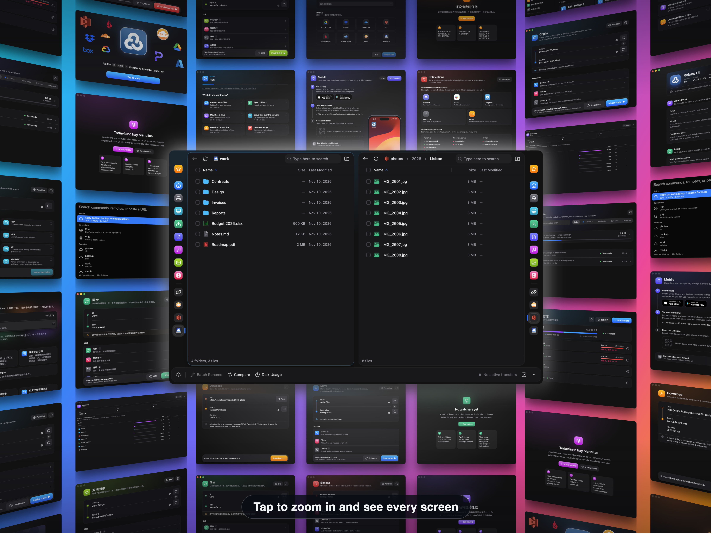

<h1 align="center">
  
   
  <a href="https://rcloneui.com">
    The cross-platform GUI for Rclone
  </a>
</h1>

<h3 align="center">
  <strong>A light, transparent layer on top of <tt>rclone</tt> to manage your remotes &amp; tasks in a more user-friendly way.</strong>
</h3>

 

 

  

