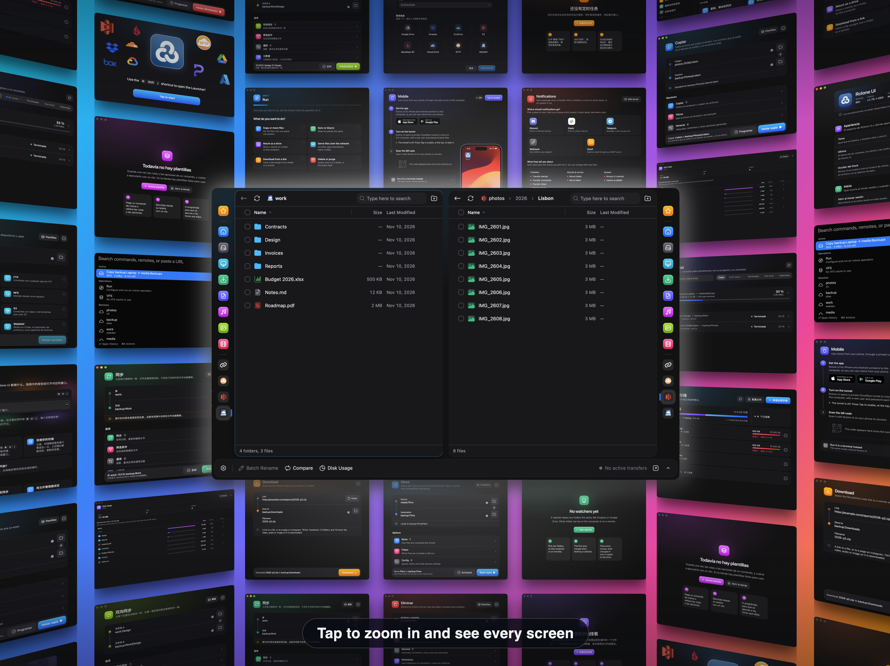

<h1 align="center">
  
   
  <a href="https://rcloneui.com">
      Rclone UI
  </a>
</h1>

<h3 align="center">
  <strong><tt>rclone</tt> の上に載る、軽量で透明なレイヤー。リモートとタスクを管理できます。</strong>
</h3>

 

 

	
   &nbsp;
  
   &nbsp;
  

 

## ダウンロード
- **Windows** (**[Arm](https://github.com/rclone/rclone-ui/releases/download/v4.0.0/Rclone-UI-4.0.0-windows-arm64-setup.exe)**, **[x64](https://github.com/rclone/rclone-ui/releases/download/v4.0.0/Rclone-UI-4.0.0-windows-x64-setup.exe)**)
- **macOS** (**[Apple Silicon](https://github.com/rclone/rclone-ui/releases/download/v4.0.0/Rclone-UI-4.0.0-macos-arm64.dmg)**, **[Intel](https://github.com/rclone/rclone-ui/releases/download/v4.0.0/Rclone-UI-4.0.0-macos-x64.dmg)**)
- **Linux** (**[AppImage](https://github.com/rclone/rclone-ui/releases/download/v4.0.0/Rclone-UI-4.0.0-linux-x86_64.AppImage)**, **[deb](https://github.com/rclone/rclone-ui/releases/download/v4.0.0/Rclone-UI-4.0.0-linux-amd64.deb)**, **[rpm](https://github.com/rclone/rclone-ui/releases/download/v4.0.0/Rclone-UI-4.0.0-linux-x86_64.rpm)**)
- **Linux `Arm`** (**[AppImage](https://github.com/rclone/rclone-ui/releases/download/v4.0.0/Rclone-UI-4.0.0-linux-aarch64.AppImage)**, **[deb](https://github.com/rclone/rclone-ui/releases/download/v4.0.0/Rclone-UI-4.0.0-linux-arm64.deb)**, **[rpm](https://github.com/rclone/rclone-ui/releases/download/v4.0.0/Rclone-UI-4.0.0-linux-aarch64.rpm)**)

## コントリビューション
お待ちしていました……

取り組むと良い課題はこちらです：
- オープンな [**Issue**](https://github.com/rclone/rclone-ui/issues) を修正する
- 翻訳にあなたの言語を追加する（[リポジトリのクローンは不要](https://rclone.github.io/rclone-ui/)）
- どこかで紹介して、友だちにも教えてください！

## 理念
あなたが `rclone` を使うのは、データを大切にしているからです。このプロジェクトはそれを何より重視し、初心者にもベテランにも、安定した快適な体験を届けることを目指しています。

そのために、何でもこなそうとするのではなく、機能を絞り込んでいます。数分使えば、自分に合うかどうかがわかるはずです。

……合わなかったら、パワーユーザーや組織向けの [Rclone Cloud](https://github.com/rclone/rclone-cloud-beta) をチェックしてみてください。

## 1 Star = バグ 1 匹退治
<a href="https://www.star-history.com/#rclone/rclone-ui&Timeline">
 <picture>
   <source media="(prefers-color-scheme: dark)" srcset="https://api.star-history.com/svg?repos=rclone/rclone-ui&type=Timeline&theme=dark&sealed_token=ymt1q4Qq0l91e5fCgYfVLA1txvhP-b2epzcYv0PUyWAZGMjSwyU4dK7Et21VWygM8k6aZFa30W1IlpScqFoDRO9sITVkSmwI2BzpKv95JBWuJ9ujXftyeO7v0vt3IFBQb4yJSVB77XBU8p6Hr-ycR0Q_nHLbKjQulfdtsjPHgNQyBA_2kjeFFTy45dMO"" />
   <source media="(prefers-color-scheme: light)" srcset="https://api.star-history.com/svg?repos=rclone/rclone-ui&type=Timeline&sealed_token=ymt1q4Qq0l91e5fCgYfVLA1txvhP-b2epzcYv0PUyWAZGMjSwyU4dK7Et21VWygM8k6aZFa30W1IlpScqFoDRO9sITVkSmwI2BzpKv95JBWuJ9ujXftyeO7v0vt3IFBQb4yJSVB77XBU8p6Hr-ycR0Q_nHLbKjQulfdtsjPHgNQyBA_2kjeFFTy45dMO" />
   
 </picture>
</a>

 

  
  
  
  
  
  
  
  

